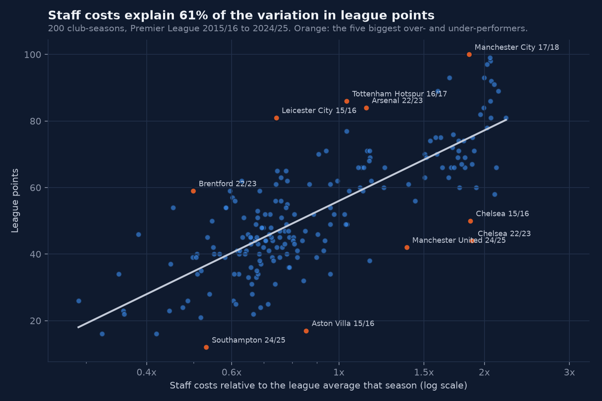
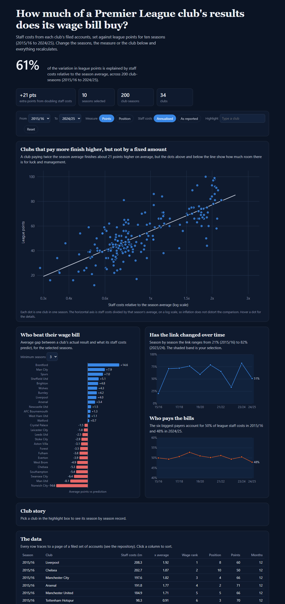

# Do Premier League wage bills buy league points?

Staff costs explain about 61% of the variation in league points across 200 club-seasons (2015/16 to 2024/25). A club that pays twice the season average finishes about 21 points higher.

That headline needs two qualifications. The link is much weaker once the six biggest payers are removed: among the other fourteen clubs, staff costs explain 26% of the variation. And it changes a lot from year to year, from 21% in 2015/16 (the Leicester title) to 82% in 2023/24.

Across ten seasons Brentford (+14.6 points a season over four seasons), Manchester City (+7.9) and Tottenham (+7.0) beat what their staff costs predict. Manchester United (-8.1), Chelsea (-5.3) and Southampton (-5.4) fell short.





[Open the interactive dashboard](dashboard/index.html). It recalculates the model for any range of seasons, switches between points and league position, and lets you highlight a club.

## What the project does

1. Downloads ten seasons of Premier League results and builds each season's league table.
2. Finds each club's legal entity at Companies House and lists every set of accounts it filed.
3. Reads the staff costs note from the filed accounts. The documents are scanned images, so the page is found with OCR and the figures are read from the page image and checked.
4. Loads everything into SQLite and builds SQL views (a join, window functions and aggregation).
5. Fits a simple model, tests how stable it is, and draws the charts.
6. Publishes an interactive HTML dashboard.

## Repository layout

```
football-wages/
  README.md
  requirements.txt
  data/
    football.db              SQLite database (matches, league_table, staff_costs)
    club_companies.csv       which Companies House entity was used for each club, with notes
    staff_costs.csv          every figure read from an accounts page, with PDF and page reference
    verification_log.csv     independent re-reads used to check the dataset
    raw/                     downloaded files (not committed)
    processed/               filings list, page images, analysis output
  src/                       numbered scripts, run in order
  sql/01_views.sql           the SQL views
  charts/                    static charts made with pandas and matplotlib
  dashboard/index.html       interactive dashboard (open in a browser)
  docs/                      data dictionary, cleaning log, Power BI guide
  BUILD_LOG.md               what was done at each step and why
```

## How to run it

You need Python 3.12 and, for the OCR step only, Tesseract. A Companies House API key goes in `.env` (see `.env.example`).

```
pip install -r requirements.txt
python src/01_fetch_results.py
python src/02_build_db.py
python src/03_find_companies.py
python src/04_list_filings.py
python src/05_download_and_locate.py
python src/06_load_staff_costs.py
python src/07_run_sql.py
python src/09_analysis.py
```

`data/staff_costs.csv` is committed, so steps 3 to 5 only need repeating if you want to rebuild it.

## Data sources

| Source | What it gives | Access |
|---|---|---|
| football-data.co.uk | Match results for every Premier League season | Free CSV download |
| Companies House API | Filing history and the filed accounts (PDF) for each club | Free API key, polite rate limit |

Staff costs are not available as a dataset. They sit in the notes to each club's annual accounts.
All data comes from public sources: football-data.co.uk results and filed accounts at Companies House.

## Method in brief

- wage index = a club's staff costs divided by the average for that season, which removes inflation.
- Model: points = a + b x ln(wage index), with standard errors clustered by club.
- Residual = points above or below what the model predicts.
- Periods that are not 12 months (year-end changes and the 2020 extension) are scaled to 12 months.

## How stable is the result

| Check | R-squared | Points from doubling staff costs |
|---|---|---|
| All 200 club-seasons, annualised | 0.61 | +21.2 |
| As reported, not annualised | 0.61 | +21.1 |
| 12-month periods only (184 rows) | 0.61 | +21.4 |
| Excluding group and consolidated accounts (174 rows) | 0.60 | +20.8 |
| First five seasons / last five seasons | 0.60 / 0.62 | +21.5 / +21.0 |
| Excluding the six biggest payers each season (140 rows) | 0.26 | +17.5 |

## Data quality

Each figure was read from the page image of the filed accounts and recorded with its PDF and page number. A check on every figure confirmed that wages, social security and pension costs add to the printed total. That check caught several misreads (listed in `BUILD_LOG.md`). A second check re-read six clubs' neighbouring filings and the figures matched to the pound (`data/verification_log.csv`).

## Limitations

- Staff costs are total employee costs, not player wages. They include commercial and administrative staff, and a few clubs include stadium or other group staff.
- Some clubs file company accounts and some group accounts. The choice for each club is in `data/club_companies.csv`. Aston Villa's players sit in a different company from its other staff, so two companies are added together.
- A few figures include redundancy or exceptional items. They are kept as reported and flagged in `staff_costs.csv`.
- Averages for clubs with three or four seasons move a lot. Brentford's result rests on four seasons.
- This is an association. It does not show that spending causes points, and there is no control for owner investment, transfer fees or squad age.

## Next steps

- Add transfer spending and amortisation, which together with wages give a fuller cost of the squad.
- Look at why smaller clubs such as Brighton and Brentford beat their wage bill, using regional population and attendance data.
- Build the same dashboard in Power BI from `data/processed/club_season_analysis.csv` (guide in `docs/power_bi_guide.md`).

## Tools

Python (requests, pandas, statsmodels, matplotlib, pdfplumber, pypdfium2, pytesseract), SQLite, Tesseract OCR, plain HTML and JavaScript. Built with Claude Code as an assistant, with every figure checked against its source page.
